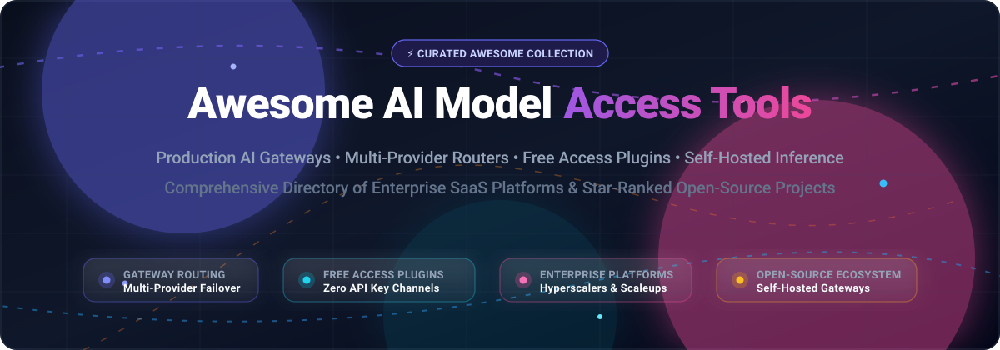

# ⚡ Awesome AI Model Access Tools 🚀

### A Curated Directory of Enterprise AI Model Gateways, Free Access Plugins, Multi-Provider Routers & Self-Hosted LLM Infrastructure

  
  
  
  
  
  

**Discover production-ready AI gateways, self-hosted LLM routers, agent runtime free access plugins, and enterprise API providers.**

*Last updated: October 2026*

---

## 📖 Table of Contents

- [🌐 Sector Overview & Market Dynamics](#-sector-overview--market-dynamics)
- [🏢 SaaS & Hosted Enterprise Platforms](#-saas--hosted-enterprise-platforms)
- [💻 Open-Source AI Gateways & Routers (Ranked by Stars)](#-open-source-ai-gateways--routers-ranked-by-stars)
- [⭐ Star History](#-star-history)
- [🤝 How to Contribute](#-how-to-contribute)
- [☕ Support & Sponsorship](#-support--sponsorship)
- [⚖️ Disclaimer](#️-disclaimer)

---

## 🌐 Sector Overview & Market Dynamics

The global AI model access and cloud inference gateway sector is estimated at **$15B - $20B** (representing an indispensable, rapidly scaling tier of the broader $100B+ generative AI infrastructure and cloud market).

The sector is **moderately concentrated at the top** among hyperscalers and frontier lab partnerships (Microsoft/OpenAI, Amazon/Anthropic, Google Cloud) which command core enterprise compliance workloads. Concurrently, it features a **vibrant, fragmented long tail** of specialized open-source inference gateways, smart multi-model routers, semantic caches, and agent runtime free access channels competing aggressively on cost optimization, latency reduction, high availability, and vendor independence.

---

## 🏢 SaaS & Hosted Enterprise Platforms

> Enterprise-grade hosted model gateways providing managed infrastructure, global edge networks, dedicated capacity, and compliance certifications (SOC 2, ISO 27001, HIPAA). Sorted by company valuation and market capitalization (descending).

| Platform | Company Scale (Valuation / Market Cap) | Starting Tier Pricing | Free Tier / Trial Limits | Description |
| :--- | :--- | :--- | :--- | :--- |
| **[Azure OpenAI Service](https://azure.microsoft.com/en-us/products/ai-services/openai-service)** | Microsoft Market Cap: ~$3.1T | $0.00015 / 1K prompt tokens, $0.0006 / 1K completion tokens (GPT-4o-mini) | 30-day trial with $200 Azure credits; includes 55+ always-free Azure services | ☁️ Microsoft's managed OpenAI models with enterprise security, compliance, and regional data residency integrated seamlessly with the Azure cloud ecosystem. |
| **[Google Vertex AI](https://cloud.google.com/vertex-ai)** | Alphabet Market Cap: ~$2.1T | $0.00001875 / 1K input characters ($0.075 / 1M tokens), $0.30 / 1M output tokens (Gemini 1.5 Flash) | 90-day trial with $300 Google Cloud credits; free tier offers up to 15 RPM / 1M TPM on select Gemini models via Google AI Studio | 🧠 Unified AI/ML platform featuring Gemini models, Model Garden, enterprise-grade MLOps, and Vertex AI Studio for prompt testing and tuning. |
| **[AWS Bedrock](https://aws.amazon.com/bedrock/)** | Amazon Market Cap: ~$1.9T | $0.00025 / 1K input tokens, $0.00125 / 1K output tokens (Claude 3 Haiku / Amazon Titan Text Express) | AWS Free Tier offers 3-month free trial of Amazon Bedrock with up to 1,000 monthly input tokens & 200 output tokens on select Titan models | 🛡️ Fully managed service for foundation models from leading AI companies featuring automated model evaluation, guardrails, RAG knowledge bases, and agent orchestration. |
| **[OpenAI API Enterprise](https://openai.com/enterprise/)** | ~$157B Valuation | $0.150 / 1M input tokens, $0.600 / 1M output tokens (GPT-4o-mini); Enterprise tier starts at ~$30/user/month (min 150 seats) | 90-day initial API signup credit of $5 (for eligible phone-verified accounts); ChatGPT free tier provides standard GPT-4o-mini access with dynamic rate limits | 🚀 Direct enterprise access to frontier GPT models with higher rate limits, dedicated capacity, SOC 2 compliance, and workspace administrative controls. |
| **[Anthropic Enterprise](https://www.anthropic.com/enterprise)** | ~$40B Valuation | $0.25 / 1M input tokens, $1.25 / 1M output tokens (Claude 3.5 Haiku); Team plan starts at $30/user/month (min 5 seats) | Free tier via web console with $5 free introductory API credits for new verified organization accounts (valid for 14 days) | 💡 Enterprise access to Claude 3.5 Sonnet and Haiku models with higher rate limits, priority support, strict privacy guarantees, and enterprise compliance. |
| **[Scale AI](https://scale.com/)** | ~$14B Valuation | Scale GenAI Platform starts at $0.02 / model call or $450/month base platform tier for self-serve labeling & fine-tuning pipelines | 30-day free trial on Scale Data Engine / Annotate with up to 500 free labeled data units | 📊 End-to-end data platform for generative AI featuring model evaluation, RLHF preference data collection, enterprise model benchmarking, and automated data curation. |
| **[Mistral Enterprise](https://mistral.ai/)** | ~$6.5B Valuation | $0.10 / 1M input tokens, $0.30 / 1M output tokens (Mistral NeMo / Ministral 3B); La Plateforme pay-as-you-go | Permanent free API tier on La Plateforme with 1 req/sec rate limit and 1 billion token/month cap on open-weight models | 🌪️ Enterprise access to Mistral's open-weight and frontier commercial models with flexible deployment options (API, cloud VPC, on-prem) and commercial licensing. |
| **[Cohere Enterprise](https://cohere.com/enterprise)** | ~$5.5B Valuation | $0.15 / 1M input tokens, $0.60 / 1M output tokens (Command R); Enterprise dedicated clusters starting from $1,500/month | Free Trial Key forever offering up to 40 requests/minute, capped at 1,000 calls/month for non-commercial prototyping | 🔍 Enterprise NLP and retrieval platform with Command and Embed models optimized for enterprise search, RAG, and private VPC deployment. |
| **[Together AI](https://www.together.ai/)** | ~$3.5B Valuation | $0.18 / 1M input tokens, $0.18 / 1M output tokens (Llama-3.1-8B-Instruct); Dedicated endpoints start at $1.00/GPU-hour | Free $5 inference credit upon account verification, valid for 90 days across all hosted open-source models | ⚡ Full-stack generative AI cloud platform with ultra-fast managed inference for open models, instant serverless endpoints, auto-scaling, and fine-tuning. |
| **[AI21 Labs](https://www.ai21.com/)** | ~$1.4B Valuation | $0.30 / 1M input tokens, $0.30 / 1M output tokens (Jamba 1.5 Mini); Studio Starter at $29/month | 90-day free trial with $10 in API credits upon registration; free sandbox access limited to 3 RPM | 🧬 Enterprise NLP platform powered by Jamba hybrid SSM-Transformer architecture models, specialized reasoning APIs, and contextual task engines. |

---

## 💻 Open-Source AI Gateways & Routers (Ranked by Stars)

> Open-source gateways, local runtime model runners, intelligent cost routers, semantic caches, and agent plugins. Sorted in descending order by GitHub stargazers count.

| Project & Repository | GitHub_Stars | License | Key Capabilities & Highlights |
| :--- | :---: | :---: | :--- |
| **[Ollama](https://github.com/ollama/ollama)** |  | MIT | 🦙 Get up and running with Llama 3, Mistral, Gemma 2, DeepSeek, and other large language models locally. Provides an OpenAI-compatible REST API, CLI tool, model library, and multi-GPU acceleration out of the box. |
| **[vLLM](https://github.com/vllm-project/vllm)** |  | Apache-2.0 | 🏎️ High-throughput and memory-efficient LLM serving engine. Powered by PagedAttention, continuous batching, chunked prefill, speculative decoding, and native OpenAI-compatible server APIs. |
| **[OmniRoute](https://github.com/diegosouzapw/OmniRoute)** |  | MIT | 🔌 Free AI gateway providing unified access to 90+ free API providers for coding harnesses (Claude Code, DeepSeek Harness). Features automated fallback on rate limits, intelligent model switching, and prompt token compression. |
| **[LiteLLM](https://github.com/BerriAI/litellm)** |  | MIT | 🔀 The de facto multi-provider proxy gateway. Call 100+ LLMs (OpenAI, Anthropic, Bedrock, Vertex, Ollama) using the standard OpenAI input/output format. Features key management, cost tracking per team, fallback routing, rate limiting, and budgeting. |
| **[Kong AI Gateway](https://github.com/Kong/kong)** |  | Apache-2.0 | 🦍 Cloud-native API gateway equipped with AI Gateway plugins: multi-LLM routing, credential management, prompt decoration, prompt guardrails, semantic caching, and unified usage analytics. |
| **[One API](https://github.com/songquanpeng/one-api)** |  | MIT | 🌐 Standard OpenAI API format aggregator supporting all major commercial and open-source models. Features multi-token distribution, quota management, user billing, load balancing, and multi-channel redundancy. |
| **[dsh-our-free-model](https://github.com/Ebony-Vinyl/dsh-our-free-model)** |  | MIT | 🆓 Widely adopted free model access plugin for DeepSeek Harness. Access frontier models (DeepSeek V4.1 Flash, Kimi K3) with zero login, sign-up, or API keys; transparent routing via OpenCode Zen and Kilo channels with local token dashboards. |
| **[Apache APISIX AI Gateway](https://github.com/apache/apisix)** |  | Apache-2.0 | ⚡ Dynamic, real-time, high-performance API gateway with AI proxy plugins for routing, token-bucket rate limiting, prompt transforms, security checks, and load balancing across multi-cloud model endpoints. |
| **[Portkey Gateway](https://github.com/Portkey-AI/gateway)** |  | Apache-2.0 | 🛡️ Ultra-fast AI gateway with 250+ model connections, 45+ guardrails, automatic fallbacks, load balancing, semantic caching, conditional routing, and granular observability. |
| **[GPTCache](https://github.com/zilliztech/GPTCache)** |  | MIT | 💾 Open-source semantic cache for LLM queries that reduces API costs by up to 80% and slashes response latency by caching contextual vector embeddings of model responses. |
| **[RouteLLM](https://github.com/lm-sys/RouteLLM)** |  | Apache-2.0 | 🧠 Open-source framework by LMSYS for serving and evaluating LLM routers. Optimizes cost-quality tradeoffs by intelligently dispatching simple queries to smaller models and complex queries to frontier LLMs based on preference data. |
| **[Envoy AI Gateway](https://github.com/envoyproxy/ai-gateway)** |  | Apache-2.0 | 🚦 Envoy-native generative AI gateway extending Envoy Proxy with multi-model translation, unified credential handling, rate-limiting, and enterprise resilience policies. |
| **[dsh-opencode-free-models](https://github.com/yu-wenchao/dsh-opencode-free-models)** |  | MIT | 🔄 Free quota model plugin displaying OpenCode Zen's latest free models in chat harnesses with zero login or API keys, utilizing IP-based allocation and multi-layer availability gates. |

---

## ⭐ Star History

---

## 🤝 How to Contribute

Contributions are welcome! Please follow these simple steps to add or update projects:

1. 🍴 **Fork** the repository.
2. 📝 **Add/edit** entries in `README.md` maintaining the existing tabular formatting, Stars_Badges, and factual descriptions.
3. 🔎 Verify official links, repository stars, pricing tiers, and licensing details.
4. 🚀 **Submit a Pull Request** with a concise description of your additions.

---

## ☕ Support & Sponsorship

If you find this curated collection useful for your development, research, or enterprise infrastructure:

- ⭐ **Star** this repository on GitHub!
- 🍴 **Fork** and share it with your fellow engineers and AI builders.
- ☕ Consider buying a coffee and supporting ongoing maintenance via the [Sponsor Dashboard](https://github.com/sponsors/ishandutta2007).

Thank you for being part of the open AI community! ❤️

---

## ⚖️ Disclaimer

- 📌 This repository is a **community-curated** reference list—it is not exhaustive and does not constitute an endorsement.
- 🔒 AI model gateways handling production prompts, API keys, or enterprise payloads must comply with applicable data protection regulations (GDPR, CCPA, SOC 2) and individual provider terms of service.
- 🛡️ Free model plugins route requests through public third-party gateways. Always review upstream privacy policies and security documentation before transmitting sensitive, proprietary, or personal data.
- ⏱️ Self-hosted solutions require proper security hardening, API key rotation, credential isolation, and monitoring. Free tier availability and limits are subject to provider modifications.

---

  <b>Built for developers, researchers, and engineering teams building open, reliable AI model infrastructure.</b>

